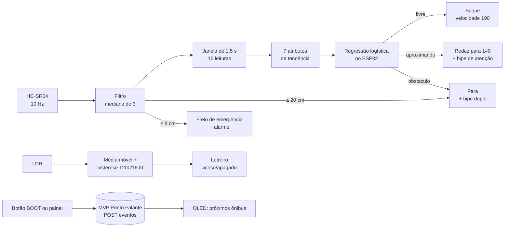
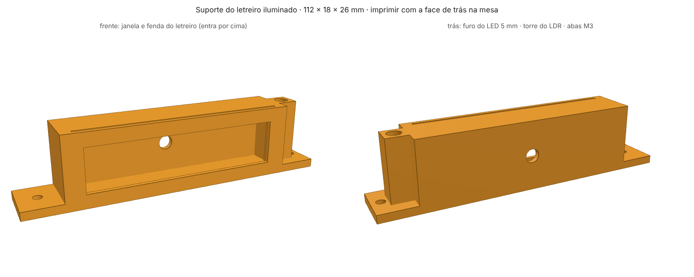
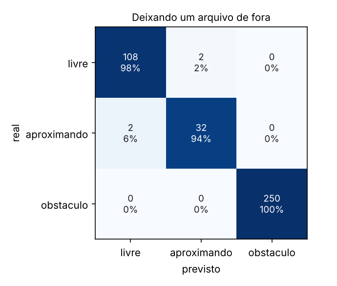

# Ponto Falante · ônibus-escala

**Project-Based Maker Lab · Global Solution 2026.2 · CitizenTech · Engenharia de Software, 4º ano (FIAP)**

Parte física do [Ponto Falante](https://github.com/pedrobicas/ponto-falante), a plataforma da equipe que ajuda pessoas
com deficiência visual e idosos a usar o ônibus em São Paulo. O carrinho faz o papel do ônibus chegando ao ponto:
percebe quem se aproxima e o que está parado à frente com uma IA que roda no próprio ESP32, reduz com aviso sonoro,
para, mantém o letreiro aceso quando escurece e conversa com o MVP pelo contrato de dispositivos.

## Integrantes

| Nome completo | RM |
|---|---|
| Pedro Henrique Bicas Couto | 99534 |
| Bryan Willian | 551305 |
| Felipe Masera Terra | 99405 |
| Gabriel Fernandes Doms | 98630 |
| Lucas Vassão Braga | 98607 |

## Vídeo de demonstração (até 6 min)

**Link:** _inserir após a gravação_ · roteiro em [`docs/roteiro_video.md`](docs/roteiro_video.md)

---

## Ficha técnica do MVP

| Campo | Resposta |
|---|---|
| **Nome do produto** | Ponto Falante (este repositório: ônibus-escala, a parte embarcada) |
| **Cidadão e território** | Pessoas com deficiência visual e idosos que usam os ônibus municipais de São Paulo; o território é o ponto de ônibus e a chegada do veículo |
| **Problema, em uma frase** | Quem não enxerga bem tem dificuldade de identificar o ônibus que chega e corre risco na hora em que ele encosta, ainda mais à noite |
| **Proposta de valor** | Um veículo que percebe sozinho quem se aproxima e o que está à frente, reage antes (reduz, avisa com som, para) e mantém o letreiro legível no escuro, sem câmera e sem dado pessoal |
| **Arquitetura: componentes** | ESP32 WROOM-32 · chassi 4WD com ponte H L298N · HC-SR04 · LDR + LED do letreiro · buzzer · OLED SSD1306 · painel web no próprio ESP32 · integração HTTPS com o MVP (Spring Boot no Render) · peça impressa em 3D. Detalhes nas seções 3 a 5 |
| **Fontes de dados** | Dados próprios do sensor: 15 séries de distância a 10 Hz ([`dataset/`](dataset/LEIAME.md)); leitura do LDR em tempo real; no MVP, previsões da SPTrans (Olho Vivo) e cadastro GTFS |
| **Modelos de IA utilizados** | Regressão logística multinomial sobre 7 atributos de tendência de uma janela de 1,5 s, treinada em Python e executada no ESP32 (38 números, sem biblioteca externa). Classes `livre`, `aproximando`, `obstaculo` |
| **Indicadores de impacto** | Seção 9 |
| **ODS conectados** | 11, 10 e 3 (seção 8) |

---

## 1. Problema e evidência

- O Censo 2022 contou **14,4 milhões de pessoas com deficiência** no Brasil (7,3% da população com 2 anos ou mais);
  **7,9 milhões** têm dificuldade permanente de enxergar, a dificuldade mais frequente
  ([IBGE, 23/05/2025](https://agenciadenoticias.ibge.gov.br/agencia-noticias/2012-agencia-de-noticias/noticias/43463-censo-2022-brasil-tem-14-4-milhoes-de-pessoas-com-deficiencia)).
- Identificar o ônibus no ponto é uma das maiores dificuldades de quem não enxerga ou enxerga pouco: sem ajuda, a
  pessoa precisa perguntar a desconhecidos ou fazer sinal para todos os ônibus
  ([Diário do Transporte](https://diariodotransporte.com.br/2011/09/25/acessibilidade-em-transportes-nem-sempre-e-preciso-muito-dinheiro/)).
  Um trabalho apresentado no 14º Prêmio Melhores Práticas de Estágio da Prefeitura de São Paulo (2025) propõe
  sensores de proximidade ligados aos ônibus, com alertas sonoros e visuais da linha que se aproxima
  ([Avança Sampa: Ponto de Ônibus para todos](https://clic.prefeitura.sp.gov.br/storage/uploads/2025/11/14/Avan%C3%A7a%20Sampa%20Ponto%20de%20%C3%94nibus%20para%20todos.pdf)).
- A Lei Brasileira de Inclusão (Lei 13.146/2015) garante o transporte "por meio de identificação e de eliminação de
  todos os obstáculos e barreiras ao seu acesso" (art. 46) e exige veículos com sistema de comunicação acessível
  (art. 48, § 1º).
- O momento da chegada também é de risco: a cidade de São Paulo teve **410 mortes por atropelamento em 2025**, 10%
  a mais que em 2024, segundo o Infosiga
  ([Portal do Trânsito, 19/01/2026](https://www.portaldotransito.com.br/noticias/fiscalizacao-e-legislacao/estatisticas/sao-paulo-volta-a-registrar-mais-de-mil-mortes-no-transito-e-pedestres-puxam-alta/)).

**Onde o carrinho entra no Ponto Falante.** O app já resolve a informação (previsão por voz, conferência do
letreiro pela câmera, assistente). O carrinho mostra o lado do veículo: a aproximação segura de quem está no ponto,
o aviso sonoro e o letreiro que continua legível à noite, que é também o que a conferência por câmera do app precisa
para ler a linha.

**Escala da demonstração:** o carrinho é o ônibus; a mão ou um objeto que chega perto é a pessoa indo até a porta;
uma caixa parada à frente é o ponto ou alguém na faixa; cobrir o LDR é o anoitecer.

## 2. O que o ônibus-escala faz



| Situação | O que o carrinho faz |
|---|---|
| Caminho livre | segue em velocidade de cruzeiro |
| Algo se aproxima (pessoa indo à porta, alguém entrando na frente) | reduz a velocidade e toca um bipe de atenção |
| Algo parado à frente, ou chegou a 20 cm | para e toca o aviso de parada |
| Parado e alguém se aproxima | continua parado |
| Caminho liberado | volta a andar depois de 1 s parado e de duas decisões `livre` seguidas |
| Algo a 8 cm ou menos | freio de emergência e alarme, independente da IA |
| Pouca luz | acende o letreiro |
| Toque no botão BOOT | pede ao MVP os próximos ônibus do ponto e mostra a resposta no display |

O carrinho funciona sozinho; o painel serve para operar, acompanhar e gravar dados.

## 3. Sensor adicional e inteligência

### 3.1 Sensor adicional: LDR (letreiro iluminado)

| Item | Valor ([`config.h`](firmware/onibus_escala/config.h)) |
|---|---|
| Sensor | LDR no GPIO 34 (ADC1, 0 = escuro, 4095 = muito claro; funciona com o Wi-Fi ligado) |
| Atuador | LED do letreiro no GPIO 27, dentro da peça impressa (seção 5) |
| Leitura | a cada 100 ms, média móvel (80% anterior, 20% nova) |
| Acende | média abaixo de **1200** |
| Apaga | média acima de **1600** (a faixa entre os dois evita piscar na meia-luz) |
| Modo manual | o painel pode forçar ligado ou desligado |

O LDR fica numa torre separada da câmara do LED, para medir a luz do ambiente e não a do próprio letreiro.

### 3.2 IA embarcada: classificador de aproximação

- **Entrada:** a distância já filtrada (sem eco ou ≥ 200 cm vira 200; < 2 cm repete a anterior; mediana de 3),
  limitada a 100 cm, porque acima disso a decisão do carrinho não muda.
- **Janela:** 15 leituras (1,5 s), nova decisão a cada 0,2 s.
- **Atributos:** última leitura, média, mínimo, desvio padrão, inclinação (cm/s, mínimos quadrados), queda entre o
  começo e o fim da janela e fração de leituras sem eco.
- **Modelo:** regressão logística multinomial (scikit-learn), padronização incluída. Os 38 números (pesos, vieses,
  médias e escalas) vão para [`modelo_aproximacao.h`](firmware/onibus_escala/modelo_aproximacao.h), gerado por
  [`ia/treinar.py`](ia/treinar.py). O ESP32 calcula os mesmos atributos e o softmax em C++, sem biblioteca de ML.
- **Decisão:** a classe vencedora vale se a confiança for ≥ 0,60; abaixo disso, mantém a decisão anterior.
- **Paridade:** o teste compara o C++ com o Python nas 394 janelas do dataset: mesma classe em todas, diferença
  máxima de probabilidade de 6 × 10⁻⁷.

**Por que atributos de tendência e não os valores brutos.** `aproximando` é definida pela queda da distância ao
longo do tempo. Com os 20 valores brutos de 2 s, o modelo acertou só 80% das janelas `aproximando` na validação, e
havia só 10 dessas janelas para treinar. Com a inclinação e a queda explícitas numa janela de 1,5 s, foram 34 janelas
e 94% de acerto (tabela completa na seção 7).

**Regras fixas acima da IA.** A janela de 1,5 s leva tempo para refletir uma mudança brusca, e um modelo treinado
com 15 gravações pode errar. Por isso o piloto para a 20 cm e freia a 8 cm a cada leitura, com ou sem a IA. A IA
serve para agir antes: na simulação de algo chegando a 40 cm/s, o carrinho reduziu a 62 cm.

**IA responsável e LGPD.** O dispositivo só mede distância e luz. Não há câmera, microfone ou identificação de
pessoas. A inferência roda inteira no ESP32 e nada do sensor sai do carrinho; o único envio é o evento do contrato
do MVP (identificador do dispositivo, ponto, tipo e horário). As regras fixas de segurança não dependem do modelo.

## 4. Integração com o MVP

O ESP32 usa o contrato de dispositivos que o MVP já publica
([`openapi-mvp.yaml`](https://github.com/pedrobicas/ponto-falante/blob/main/contratos/openapi-mvp.yaml)):

```
POST https://ponto-falante.onrender.com/api/integracoes/dispositivos/eventos
X-Device-Key: <DISPOSITIVO_API_KEY do Render>
{"dispositivo_id":"esp32-onibus-escala-01","ponto":70016916,"tipo":"BOTAO_PRESSIONADO",
 "ocorrido_em":"2026-11-18T15:04:05-03:00","bateria_pct":null}
```

| Evento | Quando | Resposta usada |
|---|---|---|
| `HEARTBEAT` | ao ligar e a cada 60 s | registra no MVP que o dispositivo está ativo (tabela `evento_dispositivo`) |
| `BOTAO_PRESSIONADO` | toque no botão BOOT ou "Próximos ônibus do ponto" no painel | `frase_falada` com os próximos ônibus do ponto, mostrada no OLED e lida em voz alta pelo painel |

- A rede roda numa tarefa separada no núcleo 0 do ESP32, com fila; o loop dos motores e do sensor nunca espera o HTTPS.
- HTTPS com verificação de certificado (raízes Let's Encrypt e Google Trust Services em
  [`certificados.h`](firmware/onibus_escala/certificados.h)).
- O relógio vem do NTP; sem hora sincronizada, o evento não é enviado (o contrato exige `ocorrido_em`).
- Chave e rede ficam em `credenciais.h`, fora do Git. Sem esse arquivo, o firmware compila com o painel local
  funcionando e a integração desligada.
- O ponto padrão é o 70016916 (Avenida Paulista, 1374), o mesmo exemplo público do MVP; a linha 875A-10 passa nele.

## 5. Hardware

| Componente | Função | Pino (ESP32) |
|---|---|---|
| Ponte H L298N | motores, controle diferencial | IN1 13, IN2 4, IN3 33, IN4 32, ENA 19 (PWM), ENB 18 (PWM) |
| HC-SR04 | distância frontal | TRIG 25, ECHO 26 |
| LDR (divisor com resistor, lado do 3V3) | luz ambiente | 34 |
| LED | letreiro | 27 |
| Buzzer | avisos sonoros | 5 |
| OLED SSD1306 128×64 | estado e resposta do MVP | I²C (SDA 21, SCL 22), endereço 0x3C |
| Botão BOOT da placa | consulta do ponto / troca de modo | 0 |

O GND do ESP32 e o da ponte H precisam estar em comum. O OLED é opcional: sem ele, o firmware segue normalmente.

### Peça modelada: suporte do letreiro iluminado



[`cad/suporte_letreiro.stl`](cad/suporte_letreiro.stl), gerado por [`cad/suporte_letreiro.py`](cad/suporte_letreiro.py)
(parâmetros no topo do arquivo). Caixa de luz de 112 × 18 × 26 mm:

- a tira do letreiro (76 × 22 mm) entra pela fenda de cima e fica presa atrás de uma janela de 70 × 16 mm;
- o LED de 5 mm entra pelo furo de trás e ilumina a câmara;
- o LDR fica na torre lateral, isolado da luz do LED, com passagem para os fios por baixo;
- duas abas com furo M3 para parafusar ou colar na frente do carrinho.

Impressão: face de trás na mesa (assim não há ponte longa), PLA, 0,2 mm, sem suporte. O letreiro para imprimir em
tamanho real está em [`cad/letreiro_875A-10.svg`](cad/letreiro_875A-10.svg).

## 6. Como reproduzir

1. **Arduino IDE 2** com o pacote de placas **esp32 da Espressif, versão 3.x** (o firmware usa `ledcAttach`). Placa:
   *ESP32 Dev Module*.
2. **Biblioteca:** *Adafruit SSD1306* pelo Gerenciador de Bibliotecas (instala a Adafruit GFX junto). Wi-Fi,
   servidor web e HTTPS já vêm no pacote esp32. Não precisa de biblioteca de IA.
3. Abra [`firmware/onibus_escala/onibus_escala.ino`](firmware/onibus_escala/onibus_escala.ino) e faça o upload
   (Monitor Serial a 115200).
4. **Painel:** no celular, entre na rede Wi-Fi `PontoFalante-Onibus` (senha `pontofalante`) e abra
   `http://192.168.4.1`. Escolha **Autônomo** para o carrinho andar sozinho, ou segure as setas no **Manual**.
   Sem o celular: segure o botão BOOT por 1 s para alternar entre manual e autônomo.
5. **Integração com o MVP (opcional):** copie `credenciais.exemplo.h` para `credenciais.h` e preencha a rede com
   internet (pode ser o roteador do celular) e a chave `DISPOSITIVO_API_KEY` (Render → serviço `ponto-falante` →
   Environment). Toque no BOOT: o display mostra os próximos ônibus do ponto. O plano gratuito do Render pode levar
   cerca de 1 minuto para acordar na primeira chamada. Se essa rede não estiver por perto, deixe `WIFI_REDE` vazio:
   enquanto tenta conectar, o ESP32 troca de canal e o painel pode cair.

Se aparecer "Sketch too big", use *Tools → Partition Scheme → Huge APP (3MB No OTA)*.

**Retreinar o modelo:** `pip install -r ia/requirements.txt` e `python ia/treinar.py`. O script refaz a validação,
regenera `modelo_aproximacao.h` e os arquivos de [`ia/resultados/`](ia/resultados/). Para gravar dados novos, use
**Coleta de dados** no painel (passo a passo no [LEIAME do dataset](dataset/LEIAME.md)).

**Testes no PC:** `bash testes/rodar.sh` (precisa de g++ e Python). Ver seção 7.

## 7. Dataset, treino, resultados e testes

| Classe | Arquivos | Amostras | Janelas de 1,5 s |
|---|---:|---:|---:|
| livre | 5 | 180 | 110 |
| aproximando | 5 | 105 | 34 |
| obstaculo | 5 | 320 | 250 |
| **Total** | **15** | **605** | **394** |

**Validação:** deixando um arquivo de fora. São 15 rodadas; em cada uma, o modelo é treinado sem nenhuma janela do
arquivo testado. Isso evita que janelas sobrepostas da mesma gravação apareçam no treino e no teste.

| Configuração (mesmo modelo) | Janelas `aproximando` | Acurácia | F1 macro | Recall `aproximando` |
|---|---:|---:|---:|---:|
| Valores brutos, 2 s | 10 | 96,2% | 0,834 | 80% |
| Valores brutos, 1,5 s, limite 100 cm | 34 | 97,2% | 0,928 | 76% |
| Atributos de tendência, 1 s | 50 | 96,3% | 0,921 | 80% |
| Atributos de tendência, 2 s | 10 | 100% | 1,000 | 100% |
| **Atributos de tendência, 1,5 s (escolhida)** | **34** | **99,0%** | **0,974** | **94%** |

A janela de 2 s acertou tudo, mas com só 10 janelas `aproximando` para treinar e testar (as gravações de
aproximação têm 2 a 2,5 s) e reagindo meio segundo mais tarde. A de 1,5 s foi o equilíbrio entre exemplos e tempo de reação.

| Classe | Precisão | Recall | F1 |
|---|---:|---:|---:|
| livre | 0,98 | 0,98 | 0,98 |
| aproximando | 0,94 | 0,94 | 0,94 |
| obstaculo | 1,00 | 1,00 | 1,00 |



Os 4 erros ficam entre `livre` e `aproximando`: duas janelas de uma aproximação lenta que começa a 96 cm viraram
`livre`, e duas janelas `livre` com um trecho sem eco seguido de leituras perto de 50 cm viraram `aproximando`.
Nenhum `obstaculo` foi confundido. Números
completos em [`ia/resultados/metricas.json`](ia/resultados/metricas.json). Com 15 arquivos, esses números dizem que
o modelo separa bem as três situações nestas gravações; não garantem o mesmo em outros ambientes (seção 10).

**Testes do firmware no PC** ([`testes/`](testes/)): o firmware real é compilado com g++ contra stubs da API do
Arduino-ESP32 e roda `setup()` e `loop()` num mundo simulado. São 79 verificações, entre elas:

- filtro, histerese do LDR, regras do piloto e leitura do JSON do MVP;
- paridade C++ × Python nas 394 janelas;
- carrinho inteiro: segue livre, reduz quando algo se aproxima, para e retoma, freio de emergência, letreiro,
  homem-morto do modo manual, botão BOOT, coleta em CSV e rotas do painel;
- o corpo do evento segue o schema `EventoDispositivo` do MVP.

O que não foi testado aqui: compilação para o ESP32 (feita na Arduino IDE), motores, sensor e a chamada HTTPS real
ao MVP. Esses ficam para o teste de bancada e o vídeo.

## 8. ODS conectados

| ODS | Como o ônibus-escala contribui |
|---|---|
| **11. Cidades e comunidades sustentáveis** | Meta 11.2: transporte acessível, com atenção a pessoas com deficiência e idosos. O veículo reage a quem chega ao ponto e mantém a identificação legível à noite. |
| **10. Redução das desigualdades** | Meta 10.2: inclusão independente de deficiência. O alvo é quem hoje depende de desconhecidos para pegar o ônibus certo. |
| **3. Saúde e bem-estar** | Meta 3.6: reduzir mortes e lesões no trânsito. Redução de velocidade e parada antes do contato, com regras fixas acima da IA. |

## 9. Indicadores de impacto (propostos)

| Indicador | Como medir |
|---|---|
| Distância em que o veículo começa a reduzir | log `[IA]` no Serial: distância na primeira decisão `aproximando` (62 cm na simulação a 40 cm/s) |
| Paradas antes da zona de freio | proporção de paradas acima de 8 cm sobre o total de aproximações nos testes de bancada |
| Tempo com letreiro aceso no escuro | proporção do tempo com luz abaixo de 1200 e letreiro aceso (esperado: 100%) |
| Consultas atendidas pelo MVP | respostas 202 com `frase_falada` sobre o total de toques no BOOT |
| Disponibilidade do dispositivo | `HEARTBEAT` recebidos por hora na tabela `evento_dispositivo` (esperado: 60) |

## 10. Limitações e próximos passos

- Dataset pequeno e rotulado por regras; as aproximações foram gravadas com o carrinho parado. Próximo passo: gravar
  com o carrinho andando, em outras distâncias, ângulos e materiais (o painel já grava no formato do dataset).
- O HC-SR04 tem um feixe estreito e recebe pouco eco de tecido e superfícies inclinadas.
- As velocidades (190 e 140) dependem dos motores e da bateria; calibre no chão em `config.h`.
- O contrato do MVP só tem `HEARTBEAT` e `BOTAO_PRESSIONADO`. Próximo passo: um tipo de evento para "ônibus parou no
  ponto", que daria ao MVP uma chegada observada por sensor, algo que ele hoje não tem.
- Protótipo em escala, em bancada.

## Estrutura do repositório

| Pasta | Conteúdo |
|---|---|
| [`firmware/onibus_escala/`](firmware/onibus_escala/) | Sketch do ESP32 em módulos: motores, filtro, classificador, piloto, letreiro, alertas, display, painel e cliente do MVP |
| [`ia/`](ia/) | Treino, exportação do modelo e resultados |
| [`dataset/`](dataset/) | 15 CSVs e a metodologia |
| [`cad/`](cad/) | Peça em STL, script que a gera e o letreiro para imprimir |
| [`testes/`](testes/) | Testes no PC com stubs do Arduino, validação dos JSON e painel simulado (`python testes/painel/servidor_simulado.py`) |
| [`docs/`](docs/) | Roteiro do vídeo e imagens |
